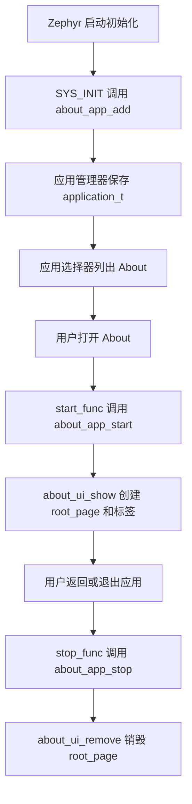

# 项目全貌与第一课：一条最小的完整调用链

源码基线：`1d4ad702b5d0242895c409243d4e189f287f9104`。本课是源码阅读练习，尚未执行运行验证。

## 1. 先把项目讲成一句话

ZSWatch 是一个开源智能手表系统：硬件使用 nRF5340 等器件，固件使用 Zephyr 实时操作系统，界面使用 LVGL，通过蓝牙与手机交互，并提供表盘、应用、通知与传感器等功能。

它同时有硬件设计和固件，不是下载一个网页项目后启动服务器就能运行的应用。其官方网页主要承载文档和升级入口；手机 Companion App 也属于独立部分，不能把当前仓库当成全部手机端代码。

| 名词 | 在这个项目里做什么 | 零基础可以怎样理解 |
| --- | --- | --- |
| C | 编写大量固件逻辑 | 告诉设备具体怎样处理数据、管理内存 |
| Zephyr / RTOS | 线程、工作队列、驱动、事件、配置与系统服务 | 给不同任务提供运行和协作规则 |
| nRF Connect SDK | 项目依赖的 Nordic SDK | 把 Zephyr 与 Nordic 芯片的软件支持组织起来 |
| LVGL | 文字、图片、按钮、布局等界面对象 | 手表屏幕的 UI 工具箱 |
| BLE | 手机与手表之间的低功耗蓝牙通信 | 一条通信通道，还需要上层数据协议 |
| zbus | 模块间的数据发布与订阅 | 模块通过频道交换消息；执行方式要看 observer 类型 |
| Kconfig | 功能选项、参数和依赖 | 决定哪些能力加入当前固件 |
| Devicetree | 描述板卡上的器件、连接与资源 | 告诉驱动硬件是什么、接在哪里 |
| CMake / west | 组织源码、依赖和构建 | 按目标板与配置把源码变成程序 |

这些术语先认识用途即可。第一课用到的 C 知识只有结构体、指针、函数和函数指针，不要求先学完所有嵌入式知识。

## 2. 仓库地图

| 路径 | 内容 | 第一阶段阅读程度 |
| --- | --- | --- |
| `app/src/main.c` | 系统启动与模块连接 | 看函数名和初始化顺序，先不逐行阅读 |
| `app/src/applications/` | 每个手表应用的业务和 UI | 从 About 开始，再看 Compass、Calc |
| `app/src/managers/` | 应用、通知、传感器、蓝牙等管理模块 | 跟随实际调用再读 |
| `app/src/events/` | 事件数据与频道定义 | 学事件通信时读 |
| `app/src/ble/` | 蓝牙传输和协议处理 | 学通知完整链路时读 |
| `app/src/drivers/`、`app/src/ext_drivers/` | 设备驱动与第三方器件库 | 对照目标板和传感器需要阅读 |
| `app/boards/` | 板级配置和模拟器配置 | 构建前读 |
| `app/west.yml` | SDK 依赖清单 | 必须核对版本 |
| `app/pytest/` | 自动化测试和模拟器运行工具 | 模拟器跑通后读 |
| `hardware/` | 由子模块引入的硬件设计仓库 | 有硬件任务后再深入 |
| `website/docs/` | 与代码一同维护的官方文档 | 与当前源码对照阅读 |
| `.github/workflows/` | 上游构建、发布和测试流程 | 自己配置 CI 时读 |

## 3. 第一课为什么读 About

`app/src/applications/about/` 只有少量逻辑，能看到一个完整应用如何注册、创建界面、销毁界面。先跑通这条线，再研究蓝牙和传感器，会更容易分清每个模块的职责。

本课读四个文件：`about_app.c`、`about_ui.c`、`about_ui.h`、`CMakeLists.txt`。再查 `app/src/managers/zsw_app_manager.h` 和 `zsw_app_manager.c` 中用到的定义。

### 第一步：结构体保存应用的身份和操作

`about_app.c` 的 `static application_t app` 保存应用名称 `About`、图标、启动函数、停止函数和分类 `ZSW_APP_CATEGORY_SYSTEM`。`start_func = about_app_start` 保存的是函数地址；这里没有立即调用该函数。

先区分两个概念：**注册**让管理器知道应用存在；**启动**才真正创建应用界面。

### 第二步：启动阶段注册应用

`SYS_INIT(about_app_add, APPLICATION, CONFIG_APPLICATION_INIT_PRIORITY)` 把 `about_app_add` 交给 Zephyr 的初始化机制。函数内部调用 `zsw_app_manager_add_application(&app)`。

注册发生在 Zephyr 的启动初始化阶段，不是用户点击图标之后。`APPLICATION` 是初始化级别名称，不能把它误读为“手表应用界面线程”。注册信息让管理器可以把 About 放进应用选择器。

### 第三步：打开后创建界面

用户打开 About 后，应用管理器调用 `app.start_func(...)`，于是进入 `about_app_start(root, group)`。它准备固件版本、编译时间、SDK 版本、文件系统统计和应用数量，再调用 `about_ui_show(...)`。

`root` 是管理器提供的 LVGL 父对象。`about_ui_show` 用 `lv_obj_create(root)` 创建自己的 `root_page`，在里面添加图片和标签，并设置布局。`CONFIG_ARCH_POSIX` 的分支体现了模拟器与硬件加载图片方式的差异。

这里涉及两个不同的“根”：管理器提供的 `root` 与应用自己创建的 `root_page`。应用退出时只清理自己拥有的界面对象。

### 第四步：退出时清理界面

管理器调用 `app.stop_func()`，进入 `about_app_stop()`，再调用 `about_ui_remove()`。它执行 `lv_obj_del(root_page)`，递归释放应用的子对象，并把指针置为 `NULL`。

About 没有自己的定时器和事件订阅，所以清理简单。更复杂的应用退出时还要停止定时器、取消订阅，并处理已排队工作，防止退出后继续访问已销毁对象。

### 第五步：构建让注册代码真正进入程序

About 的 `CMakeLists.txt` 收集当前目录的 `.c` 文件并通过 `target_sources(app PRIVATE ...)` 加进构建。父目录的应用构建逻辑遍历子目录。

因此，“有 SYS_INIT 就会出现”仍有一个前提：文件必须被编译和链接进去。新应用若使用 Kconfig 开关，还要确保该选项被父 Kconfig 引入，并在当前目标配置中启用。

## 4. 你现在应该能画出的流程

## 5. 本课练习与验收

1. 在源码中找到 About 的显示名称、分类和注册函数，并说明它们怎样关联。
2. 解释 `.start_func = about_app_start` 与 `about_app_start(...)` 的区别。
3. 解释 `&app`、`lv_obj_t *root`、`static` 在这里分别代表什么。
4. 说明创建和删除 `root_page` 的配对关系，以及不清理对象会有什么后果。
5. 用你自己的话完整讲一遍“开机 → 注册 → 点击 → 显示 → 返回 → 清理”，再对照源码纠正。

后续环境准备完成后，再做最小运行练习：只修改 About 的一处文字，在模拟器中比较前后显示，验证关闭后再次打开正常。**本轮没有替你修改该功能，也没有宣称这个练习已完成。**

第一课完成并不意味着已经掌握项目。下一课继续读应用管理器的状态转换，尤其是“界面隐藏”与“应用停止”的差别。

来源：[上游 About 源码](https://github.com/ZSWatch/ZSWatch/tree/1d4ad702b5d0242895c409243d4e189f287f9104/app/src/applications/about)、[官方项目介绍](https://github.com/ZSWatch/ZSWatch)、[官方应用开发说明](https://zswatch.dev/docs/development/writing_apps)。
