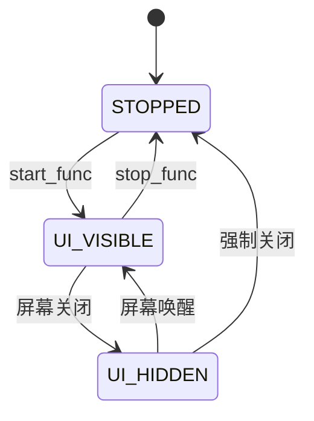

# ZSWatch 源码导读：从看懂到能做、能解释

这份资料围绕你的最终目标——做出可以诚实写进简历、经得住面试追问的个人成果。上游现有的 BLE、表盘、计步、传感器融合等能力属于原作者与社区；你学习、复现、扩展和验证的部分才是你的贡献。

研究基线：2026 年 10 月 10 日本地克隆版本，提交 `1d4ad702b5d0242895c409243d4e189f287f9104`。下方源码链接固定到这个提交，避免以后 `main` 更新造成讲解与代码不一致。本资料完成的是源码分析，尚不代表编译、模拟器运行或硬件实测已完成。

## 1. 先认识项目的五层

把 ZSWatch 看成一个运行在微控制器上的小型系统，而不是一个单独的“手表程序”。

| 层次 | 做什么 | 先读哪些路径 | 初学者怎么理解 |
|---|---|---|---|
| 板级与驱动 | 定义引脚、总线、芯片；操作硬件 | `app/boards/`、`app/drivers/` | 告诉程序“设备接在哪里、怎么读写” |
| 传感器封装 | 给业务提供读取、初始化、校准接口 | `app/src/sensors/` | 隐藏寄存器细节，提供温度、气压、加速度等数据 |
| 事件 | 定义跨模块传递的数据及频道 | `app/src/events/` | 公告栏：某模块发布，其他模块监听 |
| 管理器 | 管应用生命周期、电源状态、通知、录音等 | `app/src/managers/` | 协调各模块，维护系统规则 |
| 应用与 UI | 响应事件，显示界面，处理用户操作 | `app/src/applications/`、`app/src/ui/`、`app/lvgl_editor/` | 用户直接看到、操作的部分 |

`app/drivers/` 是补充或自定义的 Zephyr 设备驱动；`app/src/drivers/` 更多是项目对显示、振动、音频等功能的控制封装。不要因为都叫 drivers 就把它们当成同一层。

还需要认识三个“底座”：

- **Zephyr RTOS**：负责线程、工作队列、定时、设备、蓝牙等系统能力。
- **LVGL**：负责页面、按钮、文本、图片、UI 定时器及界面事件。
- **Nordic nRF Connect SDK**：项目所依赖的软件开发套件；当前 `app/west.yml` 固定的是 `v3.3.0-preview1`。不要拿一个旧教程的 SDK 版本覆盖当前 manifest。[依赖清单](https://github.com/ZSWatch/ZSWatch/blob/1d4ad702b5d0242895c409243d4e189f287f9104/app/west.yml)

## 2. 阅读源码之前，补齐这些 C 语言概念

不需要先通读一本厚教材，但以下概念遇到时必须能解释。

| 写法 | 在本项目里的实际含义 |
|---|---|
| `struct` | 把一组相关数据放在一起。例如应用名称、图标、启动函数组成 `application_t` |
| `enum` | 给状态一个名字，例如 `STOPPED`、`UI_VISIBLE`、`UI_HIDDEN` |
| `*` 与 `&` | 指针和取地址。`&app` 是应用结构体的地址，管理器通过它访问应用 |
| 函数指针 | 把“以后调用哪个函数”放入结构体。`.start_func = about_app_start` 不会当场启动应用 |
| `static` | 文件内函数不对其他文件公开；静态变量拥有持久存储，不随着函数返回消失 |
| `#ifdef CONFIG_...` | 编译阶段选择功能。没有启用的分支不会进入最终程序 |
| `SYS_INIT(...)` | 把初始化函数登记给 Zephyr，由系统启动过程调用 |
| `K_WORK_DEFINE(...)` | 创建一项可提交的后台工作；提交和实际执行是两件事 |
| `memcpy` | 按字节复制。复制含指针的结构体只复制地址，不会自动复制地址指向的字符串 |
| `snprintf` | 把数据格式化到限定大小的字符缓冲区，常用于版本号、时间及 UI 文本 |

第一个需要特别区分的点：**定义一个函数、登记这个函数、真正调用这个函数，是三个不同动作。**

## 3. 启动链：`main()` 不是所有初始化的起点

### 3.1 系统先登记应用，再进入 `main()`

Zephyr 启动时按初始化阶段运行 `SYS_INIT` 登记的函数。这里与应用框架直接相关的是：

1. `application_manager_init()` 在 `POST_KERNEL` 阶段清空应用表、设置当前应用为无效值，并监听电源状态。
2. `zsw_timer_init()` 在 `APPLICATION` 阶段、优先级 1 初始化三个周期工作项。
3. `about_app_add()` 等各应用的注册函数在 `APPLICATION` 阶段调用 `zsw_app_manager_add_application(&app)`。
4. 系统进入 `main()` 后，应用表已经登记好；但登记并不等于创建 UI。

源码证据：[应用管理器初始化](https://github.com/ZSWatch/ZSWatch/blob/1d4ad702b5d0242895c409243d4e189f287f9104/app/src/managers/zsw_app_manager.c#L336)、[周期初始化](https://github.com/ZSWatch/ZSWatch/blob/1d4ad702b5d0242895c409243d4e189f287f9104/app/src/events/zsw_periodic_event.c#L115)、[About 注册](https://github.com/ZSWatch/ZSWatch/blob/1d4ad702b5d0242895c409243d4e189f287f9104/app/src/applications/about/about_app.c#L66)。系统阶段含义可对照 [Zephyr 初始化文档](https://docs.zephyrproject.org/latest/doxygen/html/group__sys__init.html)。

### 3.2 `main()` 提交初始化工作后返回

[main.c:138](https://github.com/ZSWatch/ZSWatch/blob/1d4ad702b5d0242895c409243d4e189f287f9104/app/src/main.c#L138) 先检查特殊启动模式，例如外部 Flash 加载或擦除；普通启动则执行：

```c
k_work_submit(&init_work);
return 0;
```

这不是程序退出：Zephyr 的线程、系统工作队列、蓝牙和设备仍然运行。`init_work` 绑定的 [run_init_work()](https://github.com/ZSWatch/ZSWatch/blob/1d4ad702b5d0242895c409243d4e189f287f9104/app/src/main.c#L97) 会在系统工作队列线程执行。

代码注释解释了原因：初始化需要较大的栈，复用系统工作队列的栈，避免永久增大主线程栈。当前 `app/prj.conf:5` 设置 `CONFIG_SYSTEM_WORKQUEUE_STACK_SIZE=9500`。这是资源受限设备中很适合面试讲解的取舍。

普通初始化顺序是：

```text
run_init_work
  → zsw_coredump_init                    初始化崩溃诊断
  → zsw_display_control_init            显示控制
  → zsw_display_control_sleep_ctrl(true) 唤醒显示
  → zsw_notification_manager_init       通知存储
  → enable_bluetooth                    蓝牙及手机服务
  → zsw_imu_init                        IMU
  → zsw_magnetometer_init               磁力计
  → zsw_pressure_sensor_init            气压传感器
  → zsw_light_sensor_init               光照传感器
  → zsw_power_manager_init              活跃、休眠、静止状态
  → zsw_ui_controller_init              输入、首次引导、表盘
  → 可选的麦克风与语音备忘录初始化
```

注意：不是每个初始化函数的返回值都在这个入口被检查。看到“调用过”不等于可以断言“硬件初始化成功”。真实复现时要看设备就绪情况和日志。

### 3.3 UI 的刷新是谁驱动的？

不是 `main()` 中的一个 `while(1)`。

[zsw_display_control.c:349](https://github.com/ZSWatch/ZSWatch/blob/1d4ad702b5d0242895c409243d4e189f287f9104/app/src/drivers/zsw_display_control.c#L349) 的 `lvgl_render()` 是一个延迟工作回调：

```text
系统工作队列运行 lvgl_render
  → 检查 render_enabled
  → lvgl_lock
  → lv_task_handler
  → lvgl_unlock
  → 按 LVGL 返回的下一次更新时间重新调度自己
```

`lv_task_handler()` 驱动 LVGL 定时器、输入和刷新。屏幕休眠时会停止这条刷新链；唤醒后重新调度。当前配置也启用了独立的显示 flush 线程，所以“业务更新”和“实际传输像素”并不完全是一回事。

这是本项目一个关键约定：很多业务工作及 LVGL 定时器运行在系统工作队列所驱动的路径中。不要把“提交到任意工作队列”当成所有 LVGL 项目都通用的线程安全保证；新增线程、独立队列或直接触碰 UI 时，要重新检查执行上下文与锁。

**本节验收**：不看资料，能解释“为什么 `main()` 返回后手表继续运行”“为什么应用注册早于 UI 创建”“为什么选择复用工作队列栈”。

## 4. 第一课：完整读懂 About 应用

建议第一课选择 **About**，它是一个可见应用，只有注册、整理显示文本、创建 UI 和删除 UI；没有 BLE、传感器、算法及业务状态机的干扰。

依次读：

1. `app/src/applications/about/about_app.c`
2. `app/src/applications/about/about_ui.h`
3. `app/src/applications/about/about_ui.c`
4. `app/src/applications/about/CMakeLists.txt`

### 4.1 应用信息表不是 UI

[about_app.c:34](https://github.com/ZSWatch/ZSWatch/blob/1d4ad702b5d0242895c409243d4e189f287f9104/app/src/applications/about/about_app.c#L34) 定义：

```c
static application_t app = {
    .name = "About",
    .icon = ZSW_LV_IMG_USE(templates),
    .start_func = about_app_start,
    .stop_func = about_app_stop,
    .category = ZSW_APP_CATEGORY_SYSTEM,
};
```

这是一张“应用名片”。`.start_func` 指定以后启动时调用哪个函数；`.category` 决定它出现在 System 文件夹。底部 `SYS_INIT` 登记 `about_app_add()`，注册的是这张名片。

### 4.2 用户打开 About 时才生成文本与界面

[about_app_start():42](https://github.com/ZSWatch/ZSWatch/blob/1d4ad702b5d0242895c409243d4e189f287f9104/app/src/applications/about/about_app.c#L42) 整理板卡目标、固件版本、SDK 版本、编译时间、文件系统统计和已注册应用数量，再调用 `about_ui_show()`。

[about_ui_show():37](https://github.com/ZSWatch/ZSWatch/blob/1d4ad702b5d0242895c409243d4e189f287f9104/app/src/applications/about/about_ui.c#L37) 的关键动作：

```text
lv_obj_create(root)                   创建应用自己的根容器 root_page
  → 设置大小、排列、背景等
  → 创建图片和文字对象
  → 把传入的版本信息写到标签里
```

`root` 是管理器提供的公共父对象，`root_page` 是 About 自己创建、自己负责清理的子对象。不要删除别人的公共父对象。

### 4.3 关闭时，清理由应用负责

`about_app_stop()` 调用 `about_ui_remove()`。后者 `lv_obj_del(root_page)` 并把指针置空；删除父对象会连同子对象一起删除。[删除代码](https://github.com/ZSWatch/ZSWatch/blob/1d4ad702b5d0242895c409243d4e189f287f9104/app/src/applications/about/about_ui.c#L132)

这里的 `assert(root_page == NULL)` 是一个很好的阅读入口：它要求旧页面已经清理，避免重复创建。它是代码约束，不是已经证明不存在资源泄漏。

### 4.4 适合零基础的三个练习

这些是后续练习，不是本次已经完成的个人功能。

| 练习 | 修改目标 | 可验证结果 | 能说明什么 |
|---|---|---|---|
| A：加一行自定义文本 | 只改 About UI | 截图显示新文本且圆形屏幕不遮挡 | 理解 LVGL 标签和布局 |
| B：做独立的学习信息应用 | 新建自己的应用目录，复用注册模式 | 出现在应用选择器，能打开关闭 | 理解构建发现、注册与生命周期 |
| C：加运行时间显示 | 在 B 中加入周期刷新及退出清理 | 持续刷新；退出后停止；再进入正常 | 理解计时与资源生命周期 |

前两个练习是入门成果，还不足以支撑“开发完整智能手表”这种简历表述。练习 C 完成并有证据后，可成为后续诊断应用或传感器面板的基础。

补充：Flashlight 的代码比 About 更短，但 `hidden=true`，默认不会显示在应用选择器；它通过表盘快捷事件按名称启动。因此适合作为第二个极简对照例，不适合直接照抄后再疑惑“为什么菜单里没有”。[Flashlight 注册](https://github.com/ZSWatch/ZSWatch/blob/1d4ad702b5d0242895c409243d4e189f287f9104/app/src/applications/flashlight/flashlight_app.c#L29)、[快捷入口](https://github.com/ZSWatch/ZSWatch/blob/1d4ad702b5d0242895c409243d4e189f287f9104/app/src/ui/zsw_ui_controller.c#L350)

## 5. 应用是怎样被打开、隐藏、关闭的？

### 5.1 构建发现与运行时注册是两步

`app/src/applications/CMakeLists.txt` 枚举子目录，调用每个目录的 `CMakeLists.txt`。子目录再决定有哪些 `.c` 编译进程序。编译进去之后，应用的 `SYS_INIT` 才能运行并注册。[构建规则](https://github.com/ZSWatch/ZSWatch/blob/1d4ad702b5d0242895c409243d4e189f287f9104/app/src/applications/CMakeLists.txt)

如果新增可选 Kconfig，需要在父 `Kconfig` 引入对应文件。所谓“没有中央应用列表”指不用手工登记一张总应用表，不代表不需要构建配置、图标或 Kconfig。

### 5.2 从表盘到 About 的调用链

```text
按键 INPUT_KEY_1 / 表盘向上手势
  → zsw_ui_controller 的输入或表盘事件处理
  → open_application_manager_page(NULL)
      → watchface_app_stop()
      → 切换到 APPLICATION_MANAGER_STATE
      → zsw_app_manager_show(...)
  → app_picker_ui_create(..., on_app_selected, ...)
  → 用户进入 System 文件夹，点击 About
  → folder_app_clicked_cb
  → app_selected_cb(app)
  → zsw_app_manager 的 on_app_selected(app)
  → 创建一次性 LVGL 定时器
  → async_app_start()
      → 删除选择器 UI
      → 把应用状态设为 UI_VISIBLE
      → app->start_func(root_obj, group_obj)
  → about_app_start()
  → about_ui_show()
```

为什么选择后不立即调用启动函数？当前实现用一次性 LVGL 定时器延后执行，减少在点击回调中立刻删除当前页面并创建下一页的风险。代码使用的延迟是选择器路径 50 ms、按名称直接启动路径 1 ms；这些是实现细节，不是必须死记的知识。

源码证据：[UI 控制器入口](https://github.com/ZSWatch/ZSWatch/blob/1d4ad702b5d0242895c409243d4e189f287f9104/app/src/ui/zsw_ui_controller.c#L176)、[文件夹点击](https://github.com/ZSWatch/ZSWatch/blob/1d4ad702b5d0242895c409243d4e189f287f9104/app/src/ui/app_picker/app_picker_ui.c#L326)、[选中与启动](https://github.com/ZSWatch/ZSWatch/blob/1d4ad702b5d0242895c409243d4e189f287f9104/app/src/managers/zsw_app_manager.c#L122)。

### 5.3 生命周期状态机



状态定义见 [zsw_app_manager.h:50](https://github.com/ZSWatch/ZSWatch/blob/1d4ad702b5d0242895c409243d4e189f287f9104/app/src/managers/zsw_app_manager.h#L50)。

- `STOPPED`：本应用没有运行中的界面。
- `UI_VISIBLE`：本应用可更新界面。
- `UI_HIDDEN`：本应用仍在运行，但屏幕已关闭，应暂停不必要的 UI 更新。

`UI_HIDDEN` 不等于 `STOPPED`。数据可能还需要更新，例如秒表计时或音乐状态缓存；UI 对象不一定已经删除。

电源状态经 `activity_state_data_chan` 进入应用管理器的 `zbus_activity_event_callback()`。管理器先变更 `current_state`，然后调用可选 `ui_unavailable_func` 或 `ui_available_func`。[状态切换](https://github.com/ZSWatch/ZSWatch/blob/1d4ad702b5d0242895c409243d4e189f287f9104/app/src/managers/zsw_app_manager.c#L190)

### 5.4 返回动作与关闭

```text
返回按键 / 启用后的向上返回手势
  → handle_back_action
  → zsw_app_manager_exit_app
  → 一次性 LVGL 定时器
  → async_app_close
      → 可选 back_func()
      → 若返回 true：应用消耗返回动作，继续运行
      → 若返回 false：状态 STOPPED，调用 stop_func
      → 回到选择器，或结束管理器后返回表盘
```

上游框架不会替应用移除所有自建定时器和订阅；`stop_func()` 必须负责这些资源。生命周期正确，比“把一个按钮画出来”更值得写进技术项目经历。

## 6. zbus：数据通过什么路径流动？

以气压为例，频道声明的数据是：

```c
struct pressure_event {
    float pressure;
    float temperature;
};
```

`pressure_event.c` 用 `ZBUS_CHAN_DEFINE` 定义 `pressure_data_chan`；生产者通过 `zbus_chan_pub()` 发布；消费者通过 Listener 或其他 observer 形式接收。[数据和频道](https://github.com/ZSWatch/ZSWatch/blob/1d4ad702b5d0242895c409243d4e189f287f9104/app/src/events/pressure_event.c#L23)

最重要的约束：**项目中常见的 `ZBUS_LISTENER_DEFINE` 是同步监听器，回调在发布者上下文执行。** 发布者若是 BLE 线程，监听回调也在 BLE 线程；发布者若是周期工作，监听回调就在该工作队列路径中。zbus 还支持其他异步 observer 类型，但不能把它们与普通 Listener 混为一谈。[Zephyr zbus 文档](https://docs.zephyrproject.org/latest/services/zbus/index.html)

### 6.1 为什么监听回调里常常只复制数据并提交工作？

看音乐应用的真实模式：

```text
BLE 发布音乐事件
  → music 的 zbus_ble_comm_data_callback
      → memcpy 到 last_music_info / last_music_state
      → k_work_submit(&update_ui_work)
  → 系统工作队列运行 handle_update_ui
      → 检查 app.current_state == UI_VISIBLE
      → 更新 LVGL subjects
```

复制是为了保存数据，提交工作是为了转移执行上下文和减少 BLE 线程栈负担。`current_state` 检查是为了避免已经关闭或隐藏时操作 UI。三者解决的是不同问题。[音乐接收与刷新](https://github.com/ZSWatch/ZSWatch/blob/1d4ad702b5d0242895c409243d4e189f287f9104/app/src/applications/music_control/music_control_app.c#L121)

不要把 `zbus_chan_const_msg()` 返回的频道内容地址直接交给以后运行的工作。频道中的内容会随下一次发布被覆盖。

也不要认为“复制了整个事件结构体”一定足够：通知事件内有字符串指针，这种浅拷贝并不会复制实际字符串；需要复制字符串内容到有明确生命周期的存储中。

### 6.2 最新状态与逐条事件不同

音乐状态适合“显示最新一首歌”；通知、录音任务等有时需要“每条都处理”。同一个已排队的 `k_work` 不会因为反复提交而自动成为一条逐项保存所有数据的消息队列。设计消费者时，要判断是否允许中间状态合并。[Zephyr 工作队列说明](https://docs.zephyrproject.org/latest/kernel/services/threads/workqueue.html)

面试中可以这样解释：我先确认业务需要最新状态还是完整事件序列，再决定使用缓存加工作项，还是容量明确的队列；同时检查缓冲区满时的处理方式。只有你实际实现、验证之后，才能把这段设计写成自己的贡献。

### 6.3 周期事件不是不断运行的独立应用线程

三个周期频道是 100 ms、1 s、10 s，它们关联 `k_work_delayable`。`zsw_periodic_chan_add_obs()` 加入监听者，并在需要时启动周期工作；`zsw_periodic_chan_rm_obs()` 移除监听者，在没有动态监听者时取消工作。[周期机制](https://github.com/ZSWatch/ZSWatch/blob/1d4ad702b5d0242895c409243d4e189f287f9104/app/src/events/zsw_periodic_event.c#L33)

节能含义：应用不运行时退出自己的订阅，避免无意义刷新。但如果传感器等其他监听者仍然订阅，频道仍会运行；关闭一个应用不代表系统里的该周期必定停止。

## 7. 第二课：秒表，把“时间”和“刷新次数”分开

源码位置：`app/src/applications/stopwatch/stopwatch_app.c`、`stopwatch_ui.c`、`stopwatch_ui.h`。应用菜单名是 **Lap Time**，不是源码目录名 Stopwatch。

这节需要先分清两种状态：

- 应用框架状态：`STOPPED / UI_VISIBLE / UI_HIDDEN`。
- 秒表业务状态：`STOPWATCH_STATE_STOPPED / RUNNING / PAUSED`。

关闭 UI 与暂停秒表是两种行为，不能靠一个状态变量混着表达。

### 7.1 上游如何计时

[开始和暂停逻辑](https://github.com/ZSWatch/ZSWatch/blob/1d4ad702b5d0242895c409243d4e189f287f9104/app/src/applications/stopwatch/stopwatch_app.c#L83) 使用 `k_uptime_get()` 记录时间：

```text
开始：start_time_ms = 当前系统运行时间
运行：elapsed_ms = 当前系统运行时间 - start_time_ms
暂停：记录 pause_time_ms，切到 PAUSED
恢复：start_time_ms += 当前时间 - pause_time_ms
```

它不是“100 ms 回调一次就累计 100 ms”。使用系统时间差可避免回调延迟逐次累积到计时误差里。周期事件负责刷新机会，而非充当唯一的计时真相。

### 7.2 生命周期配对

`stopwatch_app_start()` 创建页面并订阅 `periodic_event_100ms_chan`；`stopwatch_app_stop()` 先取消订阅，再删除 UI。[源码](https://github.com/ZSWatch/ZSWatch/blob/1d4ad702b5d0242895c409243d4e189f287f9104/app/src/applications/stopwatch/stopwatch_app.c#L71)

周期回调继续计算业务计时，但 `update_elapsed_time()` 只在 `UI_VISIBLE` 时更新界面。因此熄屏期间与退出应用期间的行为需要分开检查：前者应用仍订阅，后者已取消自己的订阅。

### 7.3 可验证的进阶课题

做一个“暂停和圈速边界精度”的研究练习：当前 `on_pause_cb()` 和 `on_lap_cb()` 使用的显示或圈速值与最近一次周期更新相关。先设计在两次周期之间触发暂停、圈速的实验，记录实际结果，再决定是否要在按钮事件时重新取系统时间。

这是一个待实验的改进候选，不是本资料已经证实并修复的 bug。验收要包含：开始、暂停、恢复、重置、连续记圈、熄屏唤醒、关闭重开，以及期望时间与实际结果。不要只凭截图宣称“毫秒级高精度”。

## 8. BLE 主线：一条手机通知怎样变成弹窗？

不要一上来把整个蓝牙协议栈啃完。先追踪一条通知，将协议入口、分帧、解析、存储和 UI 串起来。

### 8.1 开启与连接

`main.c` 的 `enable_bluetooth()` 调 `bt_enable()`，加载 settings，初始化 `ble_comm`，并根据配置初始化 Apple AMS、CTS、ANCS。[入口](https://github.com/ZSWatch/ZSWatch/blob/1d4ad702b5d0242895c409243d4e189f287f9104/app/src/main.c#L158)

`ble_comm_init()` 注册连接鉴权回调、初始化 transport、开启广播。连接回调记录 `current_conn`，交换 MTU，并在连接初期之后请求较长连接间隔以减少功耗。[ble_comm](https://github.com/ZSWatch/ZSWatch/blob/1d4ad702b5d0242895c409243d4e189f287f9104/app/src/ble/ble_comm.c#L166)

这里要分清：广播让手机找到设备；连接建立链路；配对和加密解决鉴权；GATT 服务与特征定义数据如何读写；Gadgetbridge/Chronos 是上层消息协议。

### 8.2 Android/Gadgetbridge 的真实通知链

```text
手机向 RX 特征写入字节
  → ble_transport.c 的 on_receive
  → ble_comm.c 的 bt_receive_cb
      → ble_gadgetbridge_input(data, len)
      → ble_chronos_input(data, len)
  → Gadgetbridge 分帧状态机 WAIT_GB / WAIT_END
  → 接到完整 GB(...) 消息
  → parse_data 根据 "t" 字段选择解析函数
  → parse_notify 整理 id、src、title、sender、body 等字段
  → send_ble_data_event
  → zbus_chan_pub(ble_comm_data_chan)
  → notification_mgr_zbus_ble_comm_data_callback
      → 过滤、去重，把字符串复制到内部通知数组
      → k_work_submit(notification_work)
  → notification_mgr_update_worker
  → zbus_chan_notify(zsw_notification_mgr_chan)
  → main.c 的 on_zbus_notification_callback
      → 检查是否已有弹窗 / 是否静止未佩戴
      → 重置空闲时间
      → lv_async_call(open_notification_popup)
  → open_notification_popup
      → 获取最新通知
      → 切输入组、振动、显示通知弹窗
```

可逐步定位：[GATT 接收](https://github.com/ZSWatch/ZSWatch/blob/1d4ad702b5d0242895c409243d4e189f287f9104/app/src/ble/ble_transport.c#L29)、[字节分发](https://github.com/ZSWatch/ZSWatch/blob/1d4ad702b5d0242895c409243d4e189f287f9104/app/src/ble/ble_comm.c#L469)、[分帧](https://github.com/ZSWatch/ZSWatch/blob/1d4ad702b5d0242895c409243d4e189f287f9104/app/src/ble/gadgetbridge/ble_gadgetbridge.c#L1094)、[类型分发](https://github.com/ZSWatch/ZSWatch/blob/1d4ad702b5d0242895c409243d4e189f287f9104/app/src/ble/gadgetbridge/ble_gadgetbridge.c#L1014)、[通知解析](https://github.com/ZSWatch/ZSWatch/blob/1d4ad702b5d0242895c409243d4e189f287f9104/app/src/ble/gadgetbridge/ble_gadgetbridge.c#L485)、[通知存储](https://github.com/ZSWatch/ZSWatch/blob/1d4ad702b5d0242895c409243d4e189f287f9104/app/src/managers/zsw_notification_manager.c#L122)、[主程序弹窗入口](https://github.com/ZSWatch/ZSWatch/blob/1d4ad702b5d0242895c409243d4e189f287f9104/app/src/main.c#L215)。

这条链中一个值得深学的细节：`parse_notify()` 的字符串字段指向解析缓冲区。zbus 复制事件时不会自动深拷贝字符串，因此通知管理器在同步回调中把内容复制到自己管理的数组；然后工作项只发出“通知存储已更新”的通知。不要随意把这一步整体延后而不处理字符串生命周期。

另一个细节：通知管理器所谓“最旧/最新”当前是按通知 ID 查找，不是按本地时间戳排序。讲解时应按实现描述，不能默认所有来源的 ID 都天然等于时间。

### 8.3 发给手机的反向链

以音乐下一首为例：

```text
music_on_next_clicked
  → 发布 music_control_data_chan
  → Android 的 android_music_control_lis / iOS 的 ios_music_control_lis
  → Gadgetbridge 消息或 Apple AMS remote command
  → 手机执行音乐控制
```

Android 文本最终进入 `ble_comm_send()`，按 `max_send_len` 分块，再由 `ble_transport_send()` 通过 GATT notify 发送。连接后的默认有效载荷先设为 20 字节，MTU 交换成功后更新成 MTU 减 3。[音乐事件](https://github.com/ZSWatch/ZSWatch/blob/1d4ad702b5d0242895c409243d4e189f287f9104/app/src/applications/music_control/music_control_app.c#L90)、[发送与分块](https://github.com/ZSWatch/ZSWatch/blob/1d4ad702b5d0242895c409243d4e189f287f9104/app/src/ble/ble_comm.c#L189)

### 8.4 iOS 的入口不同，下游事件统一

Apple ANCS 负责通知、AMS 负责音乐信息与控制、CTS 负责时间。它们不走 Gadgetbridge 的 `GB(...)` 分帧，但会转换为 `ble_comm_data_chan` 上的统一事件，下游管理器和应用因此可以复用。

适合面试回答的是“多种手机协议如何汇合到共同业务事件”，而不是含糊地说“用了蓝牙协议”。

## 9. 传感器主线：气压轮询与 IMU 中断

### 9.1 气压：周期触发的一条完整链

```text
10 秒延迟工作触发
  → 发布 periodic_event_10s_chan
  → zsw_pressure_sensor 的 zbus_periodic_10s_callback
  → zsw_pressure_sensor_get_pressure / get_temperature
      → sensor_sample_fetch
      → sensor_channel_get
      → sensor_value_to_float
  → 构造 pressure_event
  → 发布 pressure_data_chan
  → 当前订阅者接收、缓存或显示
```

源码：[气压封装](https://github.com/ZSWatch/ZSWatch/blob/1d4ad702b5d0242895c409243d4e189f287f9104/app/src/sensors/zsw_pressure_sensor.c#L34)、[底层驱动](https://github.com/ZSWatch/ZSWatch/blob/1d4ad702b5d0242895c409243d4e189f287f9104/app/drivers/sensor/bmp581/zsw_bosch_bmp581.c)。

`DEVICE_DT_GET_OR_NULL(DT_NODELABEL(bmp581))` 连接的是设备树中的具体设备。设备树描述硬件，Kconfig 选择编译功能，业务 API 读取数据，三者职责不同。

新增传感器 UI 前要检查：设备是否 ready、读取错误、值的单位与范围、采样频率、过期值如何呈现、有没有模拟器数据。不要把“屏幕上出现一个数值”当成数据准确性验证。

### 9.2 IMU：手腕动作与计步是触发回调

`zsw_imu_init()` 通过 `sensor_trigger_set()` 登记 `bmi270_trigger_handler()`。触发回调把计步、步态、手腕唤醒、手势、静止或运动转换为 `zsw_imu_evt_t`，发布到 `accel_data_chan`。[IMU 触发](https://github.com/ZSWatch/ZSWatch/blob/1d4ad702b5d0242895c409243d4e189f287f9104/app/src/sensors/zsw_imu.c#L38)

频道静态观察者包括表盘和电源管理器。不是每个 IMU 数据都靠“每秒轮询一次”产生；也不要因为回调源于硬件中断就默认业务回调本身一定在 ISR 里，具体执行上下文还要查看驱动实现与配置。

### 9.3 Compass 是一条例外路径

当前 Compass 在启动时创建 `lv_timer` 并启动 `zsw_sensor_fusion`；定时回调调用 `zsw_sensor_fusion_get_heading()` 再更新 UI。融合模块的周期工作读取加速度、陀螺仪和可选磁力计，维护姿态及 heading。

因此它不是简单的“Compass 订阅磁力计频道就得到方向”。需要时再学习磁力计校准、坐标系、姿态融合、采样间隔等；零基础第一课先不要进入这一层。[Compass](https://github.com/ZSWatch/ZSWatch/blob/1d4ad702b5d0242895c409243d4e189f287f9104/app/src/applications/compass/compass_app.c#L49)、[融合采样](https://github.com/ZSWatch/ZSWatch/blob/1d4ad702b5d0242895c409243d4e189f287f9104/app/src/sensor_fusion/zsw_sensor_fusion.c#L102)

## 10. 电源状态如何影响应用？

```text
用户长时间不操作 / 朝向判定 / 特定手势
  → zsw_power_manager 的 enter_inactive
      → 先发布 INACTIVE
      → 停止显示刷新、关闭背光、挂起显示和触摸
      → 降低 CPU 频率
      → 打开无运动检测
  → IMU 检测到无运动
      → 关闭显示供电
      → 发布 NOT_WORN_STATIONARY

手腕唤醒 / 按键
  → enter_active
      → 恢复 CPU、供电与显示
      → 发布 ACTIVE
      → 调度空闲和姿态检测工作
```

[电源状态实现](https://github.com/ZSWatch/ZSWatch/blob/1d4ad702b5d0242895c409243d4e189f287f9104/app/src/managers/zsw_power_manager.c#L196)、[显示休眠](https://github.com/ZSWatch/ZSWatch/blob/1d4ad702b5d0242895c409243d4e189f287f9104/app/src/drivers/zsw_display_control.c#L114)。

应用管理器监听 `ACTIVE` 与非 `ACTIVE`，调整应用的 UI 可用状态；表盘有单独的活动状态监听和生命周期。不要把普通应用列表与表盘列表混成一个机制。

要宣称“降低功耗 X%”，必须有设备、基线、测量条件、仪器或可信测量方式，以及修改前后数据。仅在模拟器里熄屏、读懂状态机或减少订阅，无法证明真实电流下降多少。

## 11. 官方文档哪些表述需要结合当前源码理解？

这不是说官方文档不能用，而是提醒你养成版本意识。

| 官方文档表述 | 当前源码证据 | 学习时的准确说法 |
|---|---|---|
| 模块数据由 listeners/subscribers 异步接收 | 大量 `ZBUS_LISTENER_DEFINE`；Zephyr 区分不同 observer 类型 | 普通 Listener 同步执行，异步与否取决于 observer 和是否另外提交工作 |
| 监听器调度 work 在“main thread”更新 UI | 显示刷新是 `K_WORK_DELAYABLE_DEFINE(lvgl_work, lvgl_render)`，调用 `lv_task_handler` | 当前项目由系统工作队列驱动 UI 路径；主线程、工作队列线程不能混称 |
| `environment_data_chan`、环境传感器层 | 当前 `app/src/events/` 和 `app/src/sensors/` 中未见这个频道/模块 | 该表格有历史遗留项；优先采用所选提交存在的源码 |
| `accel_data_event` 类型示例 | 实际头文件定义 `struct accel_event` | 用真实类型和文件名检索 |
| 为应用加目录会被自动发现 | CMake 枚举子目录，但子目录仍需源码规则；可选配置还需父 Kconfig 引入 | 区分构建发现、编译入固件、启动注册三个阶段 |
| 传感器都走 periodic → zbus → App | IMU 触发、Compass 融合读取、普通周期传感器并存 | 这是常见模式，不是所有数据唯一的调用链 |
| 所有 UI 更新都应先检查应用状态 | 不同上游应用的保护方式不完全一致；LVGL 定时器可随显示刷新暂停 | 新应用显式设计隐藏和关闭行为，不能只照抄一个应用就默认完整 |

官方资料位置：[架构文档](https://github.com/ZSWatch/ZSWatch/blob/1d4ad702b5d0242895c409243d4e189f287f9104/website/docs/development/architecture.md)、[应用开发文档](https://github.com/ZSWatch/ZSWatch/blob/1d4ad702b5d0242895c409243d4e189f287f9104/website/docs/development/writing_apps.md)。

## 12. 按什么顺序学，才会形成真实的简历项目？

每一步都应留下代码、日志、截图或测试记录，不靠“看了几天源码”判断完成。

| 阶段 | 学习目标 | 可验证产物 | 可以诚实描述的程度 |
|---|---|---|---|
| 0 | 看懂上游与个人仓库关系，固定基线 | 来源说明、版本号、自己的仓库链接 | 建立学习与扩展仓库 |
| 1 | 补 C、Git、构建配置概念 | 能解释 About 注册到关闭的调用链 | 源码学习，尚非独立功能贡献 |
| 2 | 复现模拟器构建与启动 | 构建日志、操作截图、准确环境清单 | 在具体环境复现项目 |
| 3 | 做自己的小应用 | 独立目录、UI、注册与清理、演示 | 基于框架开发了某应用 |
| 4 | 接一个事件或传感器主题 | 数据路径、异常处理、模拟输入、结果 | 完成事件驱动功能扩展 |
| 5 | 做一个有价值的改进 | 需求、修改前问题、修改、回归结果 | 解决具体问题，而非只是换颜色 |
| 6 | 深讲线程、时间、资源边界 | 调用链图、生命周期测试、失败案例 | 解释设计取舍及可验证局限 |
| 7 | 有硬件时再做实机 | 烧录、手机联调、测量记录 | 在真实设备验证相应功能 |
| 8 | 整理展示与简历 | README、个人提交、演示、简历表述 | 与事实一致的个人项目经历 |

优先选择一个完整的小主题，例如“运行状态诊断应用”“带异常状态提示的传感器面板”或“秒表边界精度改进”。不要求你在短时间内重新造出所有手表功能。

推荐的阅读顺序：About → 应用管理器与 UI 控制器 → Stopwatch 与周期事件 → Music 与 zbus 数据拷贝 → 通知链 → Power Manager → 气压与 IMU → Compass/Fusion → 有需要再读录音、SMP、XIP。

## 13. 面试自测：这些问题能不能用代码回答？

1. **`main()` 为什么没有主循环？** 能定位 `k_work_submit`，解释系统工作队列与 RTOS 继续运行。
2. **一个应用怎么加入系统？** 能区分 CMake 编译、Kconfig 选择和 `SYS_INIT` 自注册。
3. **应用熄屏和退出有什么区别？** 能说明 UI 状态、业务数据、定时器和订阅的不同生命周期。
4. **zbus 回调运行在哪个线程？** 能按发布者与 observer 类型回答，不说“都在后台线程”。
5. **为什么 BLE 收到数据后要转工作队列？** 能分别解释栈负担、执行上下文、数据保存与 UI 状态保护。
6. **复制事件结构体能保证字符串安全吗？** 能指出通知指针与音乐固定缓冲区的差异。
7. **100 ms 更新一次的秒表为什么不能简单累计 100 ms？** 能解释系统时间差和调度延迟。
8. **通知怎样从手机到界面？** 能从 GATT 接收追踪到分帧、解析、存储、工作项和弹窗。
9. **为什么要取消周期订阅？** 能说明资源清理、关闭后回调以及其他订阅者仍存在时的行为。
10. **你做了什么，上游已有的是什么？** 能指向自己的提交、演示和验证记录，不把上游功能认领为自己的开发。

如果某个问题只能背术语，回到对应函数，自己画出一条“输入 → 数据变化 → 处理 → 输出”的链，再设计一个可观察实验。这样的理解才会转化为可以写进简历的能力。
